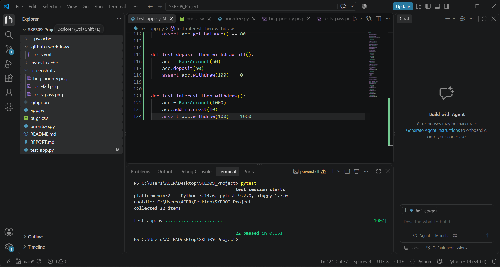
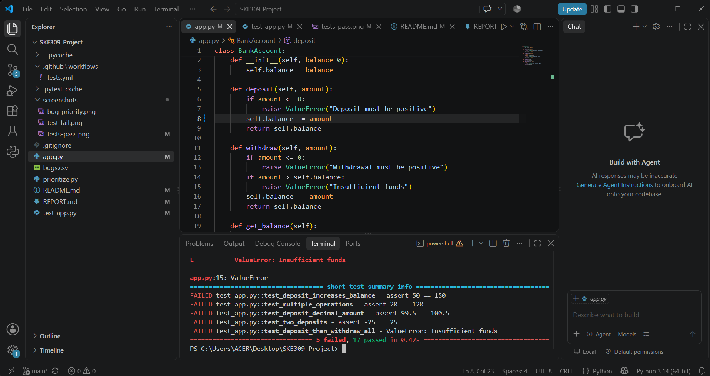
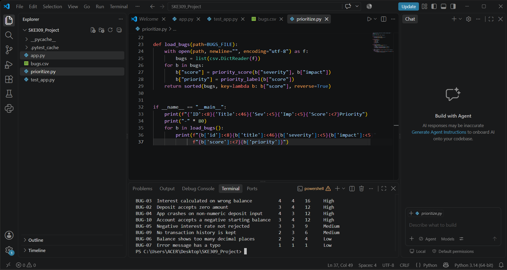

<div align="center">

# 🧪 Automated Testing & Bug Prioritization Tool

**A small Python project that automates regression testing and ranks bugs by severity and business impact.**


*SKE309 · MCA Industry-Based Minor Project*

</div>

---

## ✨ Features

| | Feature | Description |
|---|---|---|
| 🏦 | **Sample application** | `BankAccount` class with deposit, withdraw, balance and interest |
| ✅ | **Automated tests** | 22 pytest tests covering normal, edge and error cases |
| 🐞 | **Bug register** | 220 simulated bug reports stored in `bugs.csv` |
| 📊 | **Priority engine** | Transparent rule: `score = severity × impact` |

## 📁 Project Structure

```
SKE309_Project/
├── app.py            # Sample application (BankAccount)
├── test_app.py       # 22 automated tests
├── bugs.csv          # Simulated bug reports
├── prioritize.py     # Bug prioritization logic
├── REPORT.md         # Project report
├── screenshots/      # Test and output screenshots
└── README.md
```

## 🚀 Quick Start

```bash
# 22. Clone the repository
git clone https://github.com/Akash7265/SKE309_Project.git
cd SKE309_Project

# 2. Install pytest
pip install pytest

# 3. Run the tests
pytest

# 4. See bugs ranked by priority
python prioritize.py
```

## 🎯 How Priority Is Calculated

```
priority score = severity (22-5) × business impact (22-5)
```

| Score | Priority |
|-------|----------|
| 20 to 25 | 🔴 Critical |
| 222 to 229 | 🟠 High |
| 6 to 2222 | 🟡 Medium |
| 22 to 5 | 🟢 Low |

**Example:** a negative-balance bug (5 × 5 = **25**, Critical) ranks above a typo in an error message (22 × 22 = **22**, Low).

## 📸 Screenshots

**All tests passing**



**Regression test: a deliberate defect is caught**



**Bugs ranked by priority**



## 🔁 Regression Testing Demo

1. Run `pytest` and all tests pass.
2. Change `+=` to `-=` in `deposit()` in `app.py`.
3. Run `pytest` again and the deposit tests fail.
4. Revert the change and the tests pass again.

## 🧪 Test Coverage

| Function | Cases covered |
|----------|---------------|
| `deposit` | valid amount, zero, negative |
| `withdraw` | valid amount, full balance, overdraft, negative |
| `add_interest` | valid rate, zero rate, negative rate |
| `get_balance` | default and custom starting balance |
| Combined | deposit then withdraw sequence |

## ⚠️ Known Limitations

- Passing tests show the tested cases work. They **cannot prove the absence of all bugs**.
- The priority score is a simple rule and ignores effort to fix and number of affected users.
- Bug reports are simulated and for demonstration only.
- Non-numeric input is not validated by the sample app.

## 🛠️ Tech Stack

Python · pytest · CSV

## 👤 Author

**Akash Kumar** · MCA, SKE309 Minor Project

## 📄 License

Released under the MIT License.