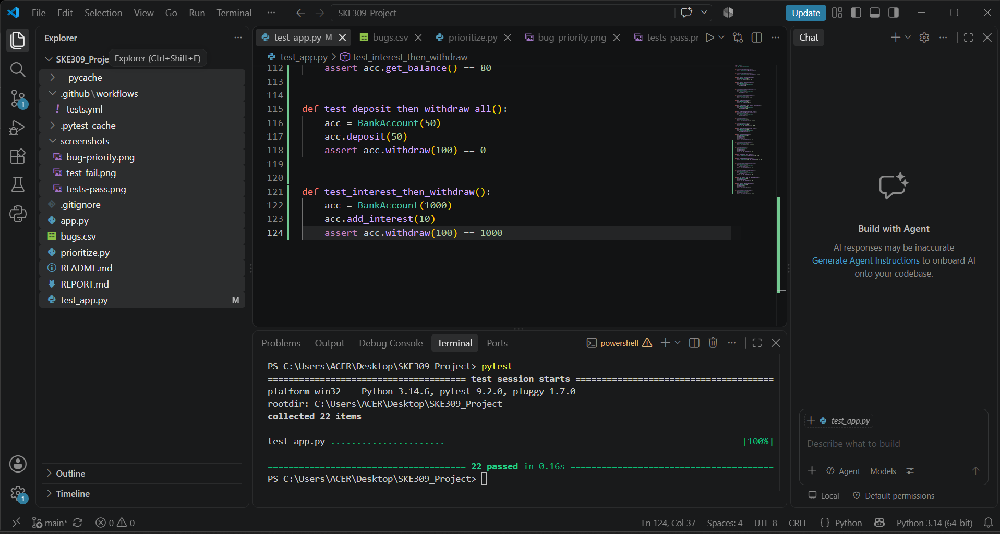
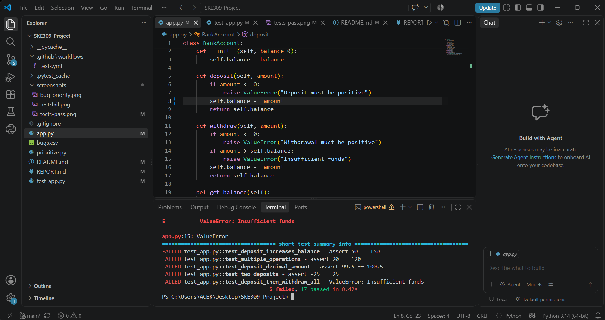
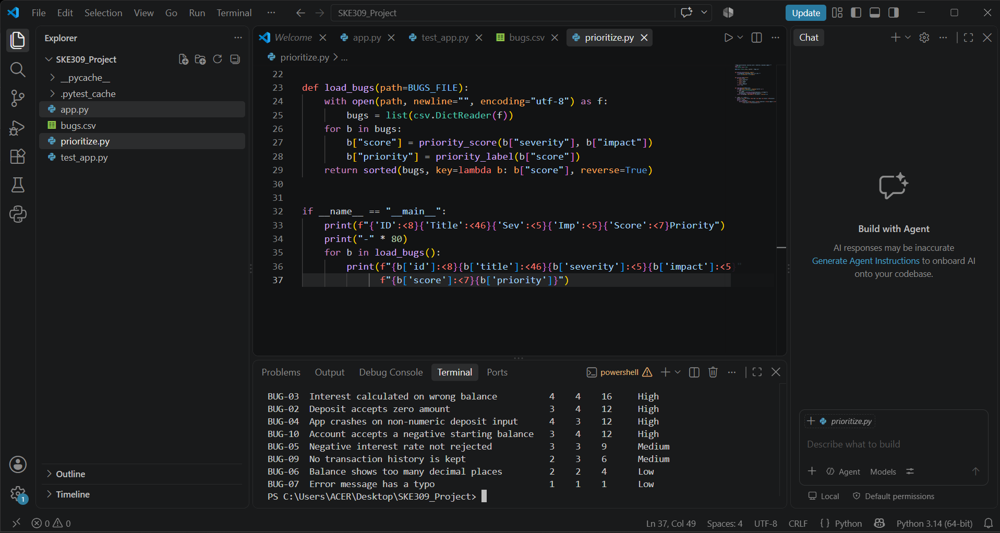

# Automated Software Testing and Bug Prioritization Tool

**Course:** SKE309, MCA Minor Project
**Name:** Akash Kumar  |  **Roll No:** A914145025058  |  **Date:** 03 November 2026

---

## 1. Introduction
Software testing checks that a program behaves as expected. Doing this manually after every change is slow and error-prone. This project builds a small application, tests it automatically with pytest, and ranks reported bugs by priority so a team knows what to fix first.

## 2. Problem Statement
Manual regression testing takes time, and teams need a consistent way to find failed functionality and prioritize bugs. This project demonstrates automated testing and a structured defect-management workflow.

## 3. Objectives
- Develop a small application with testable functions.
- Create automated functional test cases.
- Record pass/fail results.
- Categorize bug reports by severity and priority.
- Generate a test summary and defect report.

## 4. Tools and Technologies
| Tool | Purpose |
|------|---------|
| Python 3.14 | Programming language |
| pytest 9.2 | Automated test framework |
| CSV file | Storing bug reports |
| VS Code | Code editor |

## 5. System Design
| File | Purpose |
|------|---------|
| `app.py` | Sample application: a `BankAccount` class with deposit, withdraw, get_balance and add_interest |
| `test_app.py` | 22 automated unit and functional tests |
| `bugs.csv` | 10 simulated bug reports |
| `prioritize.py` | Calculates priority score and sorts bugs |

## 6. Test Results
All 22 tests passed in the first run.
Test results are logged to `test_log.txt`.

### Regression test demonstration
A deliberate defect was introduced in `deposit()` by changing `+=` to `-=`. Five tests failed (`test_deposit_increases_balance`, `test_deposit_decimal_amount`, `test_two_deposits`, `test_deposit_then_withdraw_all` and `test_multiple_operations`), while 17 tests passed. This shows that the automated tests detect the defect. The change was then reverted and all 22 tests passed again.

## 7. Bug Prioritization
Priority is calculated with a transparent rule-based formula:

**Priority score = Severity (1-5) x Business Impact (1-5)**

| Score | Priority |
|-------|----------|
| 20 to 25 | Critical |
| 12 to 19 | High |
| 6 to 11 | Medium |
| 1 to 5 | Low |

| ID | Title | Severity | Impact | Score | Priority |
|----|-------|----------|--------|-------|----------|
| BUG-01 | Withdraw allows balance to go negative | 5 | 5 | 25 | Critical |
| BUG-08 | Large deposits lose precision | 4 | 5 | 20 | Critical |
| BUG-03 | Interest calculated on wrong balance | 4 | 4 | 16 | High |
| BUG-02 | Deposit accepts zero amount | 3 | 4 | 12 | High |
| BUG-04 | App crashes on non-numeric deposit input | 4 | 3 | 12 | High |
| BUG-10 | Account accepts a negative starting balance | 3 | 4 | 12 | High |
| BUG-05 | Negative interest rate not rejected | 3 | 3 | 9 | Medium |
| BUG-09 | No transaction history is kept | 2 | 3 | 6 | Medium |
| BUG-06 | Balance shows too many decimal places | 2 | 2 | 4 | Low |
| BUG-07 | Error message has a typo | 1 | 1 | 1 | Low |

## 8. Limitations
- Passing tests only show that the tested cases work. They cannot prove the absence of all defects.
- The priority score is a simple rule and does not consider effort to fix or number of affected users.
- Bug reports are simulated and used for demonstration only.
- The application does not validate non-numeric input.

## 9. Conclusion
The project shows how automated tests detect regressions immediately and how a simple scoring rule helps a team decide which bugs to fix first. It reflects the real QA and DevOps workflow of testing, defect tracking and prioritization.